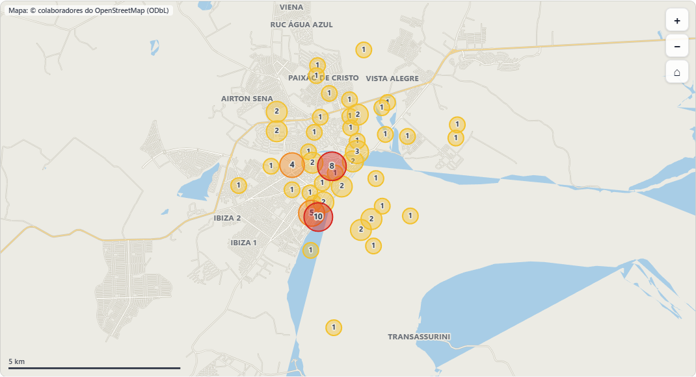

# Juntada Diária – 9º GBM Altamira (CBMPA)

**Aplicativo da guarda do quartel para lançar a juntada do serviço, imprimir as folhas oficiais, gerar o Minuto a Minuto, fazer o Livro de Partes e acompanhar as estatísticas de ocorrências.**

**Abrir o aplicativo:** https://matheuss193.github.io/JUNTADA-DIARIA-CBMPA/

| | |
|---|---|
| **Autor** | Matheus Henrique da Cruz Carvalho – SD QBM, 9º Grupamento Bombeiro Militar (Altamira) – Corpo de Bombeiros Militar do Pará |
| **Situação** | Em uso diário na guarda do 9º GBM desde 2026 |
| **Versão** | 2.1.0 (atualização de cache `juntada-v38`) |
| **Licença** | Uso institucional gratuito no CBMPA, mantido o crédito do autor ([LICENSE.txt](LICENSE.txt)) |
| **Custo** | Zero: não tem servidor, banco de dados pago nem mensalidade |

---

## 1. Por que este aplicativo existe

A juntada do serviço de 24 horas era preenchida à mão: controle de saída e entrada de viaturas, entrada e saída de militares e civis, mapa de ronda, mensagens de WhatsApp de cada ocorrência (Minuto a Minuto), dados para o REVISA e, no fim, a Parte do Comandante do Socorro no Livro de Partes. A mesma informação era escrita quatro ou cinco vezes, em papéis diferentes, por militares cansados, no meio das ocorrências.

O aplicativo faz o militar **lançar cada dado uma única vez**. O resto sai pronto:

- as **3 folhas oficiais** em A4, prontas para assinar;
- o texto do **Minuto a Minuto** para o WhatsApp;
- os dados do **REVISA** para copiar e colar;
- o rascunho da **Parte do Livro**, já com guarnição, viaturas, quilometragem e ocorrências;
- as **estatísticas e o mapa** das ocorrências da cidade.

### O ponto forte: ser fácil, rápido e intuitivo

Um sistema só ajuda o serviço operacional se for **mais rápido que o papel**. Se for lento ou complicado, o militar volta para a caneta, ou preenche só no fim do serviço, de memória. Por isso o aplicativo foi desenhado assim:

- **Abre em um segundo e funciona sem internet.** A internet do quartel cai; o aplicativo não para.
- **Nada de cadastro, senha ou login para a juntada.** Abriu, lançou.
- **Telas pensadas para o computador da guarda** (janela ao lado de outros programas) e também para o celular.
- **Sugestões enquanto digita:** nomes do efetivo, viaturas, tipos de ocorrência e guarnição de serviço.
- **Preenchimento automático:** sentinela pelo quarto de hora, hodômetro de saída pela última chegada, Cmt/condutor pela guarnição do dia, hora atual com um toque.
- **Avisa o que falta antes de imprimir** (BO, REVISA, odômetro, guarnição), mas não trava o serviço.

Esse é o recado principal para qualquer sistema oficial: **ferramenta de serviço tem que facilitar o trabalho de quem está de serviço**, não criar mais uma tarefa.

---

## 2. Como ele é usado hoje no 9º GBM

| Guia | O que faz |
|---|---|
| **Guarnição** | Cmt de Socorro, Adjunto, condutores, socorristas, guarnições de incêndio e salvamento, permutas. Gera a mensagem da guarnição para o WhatsApp. |
| **Lançamentos › Saída de viaturas** | Cada saída: viatura, tipo de ocorrência (lista padronizada por categoria), endereço, coordenada, BO, odômetros, guarnição, relato e desfecho. Várias viaturas e várias ocorrências na mesma saída. Botão de copiar os dados do REVISA. |
| **Lançamentos › Minuto a Minuto** | Texto de cada ocorrência pronto para o WhatsApp, com link do mapa e “QRA” do sentinela. |
| **Lançamentos › Pessoas** | Entrada e saída de militares e civis. |
| **Lançamentos › Quarto de hora** | Mapa de ronda (sentinela e rondante por horário). |
| **Cartões** | Controle dos cartões de combustível (quem levou, quando devolveu). |
| **Folhas** | As 3 folhas oficiais em A4 paisagem para imprimir ou mandar em PDF, com conferência antes de imprimir. |
| **Painel** | Estatísticas e mapa das ocorrências (ver item 3). |
| **Livro** | Livro de Partes do Comandante do Socorro, com acesso por senha (ver item 4). |

**Onde ficam os dados:** no próprio computador (armazenamento do navegador), com cópia automática em PDF e backup numa pasta escolhida na primeira abertura. Nada é enviado para servidor. O aplicativo é instalado pelo navegador (Edge ou Chrome) como um programa comum, com ícone na área de trabalho.

**Como passa o serviço para o Comandante do Socorro:** pelo **link do Livro** no WhatsApp (os dados vão compactados dentro do próprio link, sem passar por nenhum site) ou por um **PDF com os dados dentro**.

---

## 3. Painel e estatísticas

A guia **Painel** junta as ocorrências de todos os serviços guardados no aparelho:

- **Mapa de Altamira** (funciona sem internet; ruas do OpenStreetMap embutidas no aplicativo) com **círculos por área**: amarelo para poucas ocorrências, laranja para médio e vermelho para muitas. Tocando no círculo aparecem os tipos de ocorrência daquela área, o mais comum, os bairros e as ruas.
- **Filtros que mudam tudo ao mesmo tempo** (mapa, números, gráficos e lista): período, categoria, tipo de ocorrência, viatura, bairro e busca livre (rua, BO, nome, palavra do relato).
- **Gráficos:** por tipo, por categoria, por hora do dia, por dia da semana, por mês, por viatura, ruas e bairros com mais ocorrências.
- **Lista completa** de todas as ocorrências, com **exportação para planilha (CSV/Excel)**.

> Hoje cada quartel enxerga só os próprios dados. Com um servidor central, o mesmo painel mostraria o estado inteiro (item 6).

---

## 4. Livro de Partes digital

- Cada Comandante do Socorro entra com **a própria senha**; o primeiro cadastrado é o administrador.
- A Parte já começa preenchida com a juntada do dia: recebimento e passagem do serviço, guarnição, energia, combustível e Km das viaturas, juntada de documentos e ocorrências por grupo (Incêndio; Salvamento; Prevenção, Auxílio e APH) com o número do BO.
- Participações (item VII) com modelos prontos: permuta, abastecimento, deslocamento, avaria, visita, instrução etc.
- **Encerrar** trava a Parte. Correções depois disso entram como **Ressalva** ou **Aditamento**, anexados no fim.
- Cada Parte encerrada recebe um **código de verificação (hash)** ligado à Parte anterior. Se alguém alterar uma Parte antiga, a cadeia acusa.
- PDF em A4 com brasão, cabeçalho oficial, itens separados, rodapé com número da página e código de verificação, e campos de assinatura do Comandante do Socorro e do SubComandante.

**Assinatura hoje:** fora do aplicativo (impressão e caneta, ou assinatura eletrônica gov.br no PDF). O app só registra que foi assinada.

---

## 5. Tecnologia (para a equipe técnica)

- **PWA** (aplicativo web instalável): um único arquivo HTML com JavaScript e CSS puros, sem framework e sem dependências externas.
- **Offline:** service worker com cache; abre sem internet depois da primeira vez.
- **Dados:** `localStorage` e IndexedDB do navegador, com backup em arquivo e PDF diário automático numa pasta local (File System Access API no Edge/Chrome).
- **PDF:** gerado no próprio aparelho (gerador vetorial próprio, sem biblioteca).
- **Mapa:** ruas de Altamira extraídas do OpenStreetMap (© colaboradores do OpenStreetMap, licença ODbL) e desenhadas em `<canvas>`.
- **Hospedagem atual:** GitHub Pages (só arquivos estáticos). Pode ser hospedado em qualquer servidor web do Estado.
- **Testes:** ponta a ponta com Playwright (cerca de 20 roteiros automáticos) a cada versão.

---

## 6. Como levar para todo o CBMPA

O aplicativo já resolve o problema de **um quartel**. Para servir **todos os quartéis** e alimentar a **Central de Inteligência**, o caminho natural é ligá-lo a um servidor oficial. A proposta abaixo é uma sugestão para ser avaliada pela área de tecnologia do CBMPA e, se for o caso, pela PRODEPA ou por quem mantém os sistemas oficiais da Corporação (por exemplo o SIGA, se for o sistema adotado).

### Etapa 1 – Piloto ampliado (sem custo, imediato)
- Configurar o aplicativo para outros GBMs: nome da unidade, viaturas, efetivo e destinatário da Parte já são configuráveis na tela.
- Hospedar o mesmo arquivo num endereço oficial (`*.pa.gov.br`), no lugar do GitHub.
- Padronizar a **lista de tipos de ocorrência** com a Central de Inteligência, para as estatísticas de todas as unidades baterem.

### Etapa 2 – Servidor central (envio dos dados)
- Uma **API simples** recebe, ao fim de cada serviço, o mesmo pacote de dados que hoje vai no link/PDF (formato JSON já pronto e documentado no código).
- O aplicativo continua funcionando offline e **envia quando houver internet**.
- Login com a conta institucional (ou gov.br), substituindo as senhas locais do Livro.
- Com servidor, o link do Livro vira um **link curto** (o servidor guarda o serviço e o link leva só um código).

### Etapa 3 – Integração com os sistemas oficiais
- **REVISA:** os dados que hoje o militar copia e cola (viatura, condutor, Cmt, horários, odômetros, endereço, PPE/BO) podem ir **direto** para o sistema, sem digitar de novo.
- **Estatísticas estaduais:** painel da Central de Inteligência com o mapa de **todas as cidades**, filtros por unidade, tipo, período e horário, para planejar prevenção, posicionamento de viaturas e escalas.
- **Frota:** quilometragem, abastecimento e viaturas na oficina, por unidade, todos os dias.
- **Efetivo:** guarnição de serviço, permutas e faltas, integradas à escala.
- **Livro de Partes oficial:** assinatura eletrônica com validade jurídica (gov.br ou certificado ICP-Brasil), tramitação para o SubComandante e o Comandante dentro do sistema, arquivo e busca centralizados. O código de verificação (hash) que o app já gera pode ser registrado no servidor no encerramento, garantindo que a Parte não foi alterada.

### Cuidados (LGPD e segurança)
- Os lançamentos têm **dados pessoais** (nomes de vítimas, documentos de civis, endereços). No servidor oficial: acesso por perfil, registro de quem acessou, criptografia no tráfego e no armazenamento, e prazo de guarda definido.
- O código-fonte completo, os testes e a documentação técnica (`AGENTS.md`) ficam à disposição da equipe que for integrar.

---

## 7. Próximos passos sugeridos para a Central de Inteligência

1. Conhecer o aplicativo em uso na guarda do 9º GBM (demonstração).
2. Definir a lista oficial de tipos de ocorrência e os indicadores que a Central quer acompanhar.
3. Escolher 2 ou 3 unidades para um piloto ampliado.
4. Avaliar com a área de TI do CBMPA e com a PRODEPA onde hospedar e como receber os dados (Etapa 2).
5. Planejar a integração com o REVISA e a assinatura eletrônica do Livro de Partes (Etapa 3).

---

## 8. Instalar e atualizar

1. Abra https://matheuss193.github.io/JUNTADA-DIARIA-CBMPA/ no **Edge** ou no **Chrome**.
2. O assistente de primeiro acesso guia a instalação, a pasta de backup e a posição da janela.
3. Atualizações chegam sozinhas: ao abrir com internet, o aplicativo baixa a versão nova (o número do cache muda a cada versão).

Guia completo do usuário: [LEIA-ME.txt](LEIA-ME.txt).

---

© 2026 Matheus Henrique da Cruz Carvalho – SD QBM – 9º GBM Altamira – CBMPA. Mapa: © colaboradores do OpenStreetMap (ODbL).
